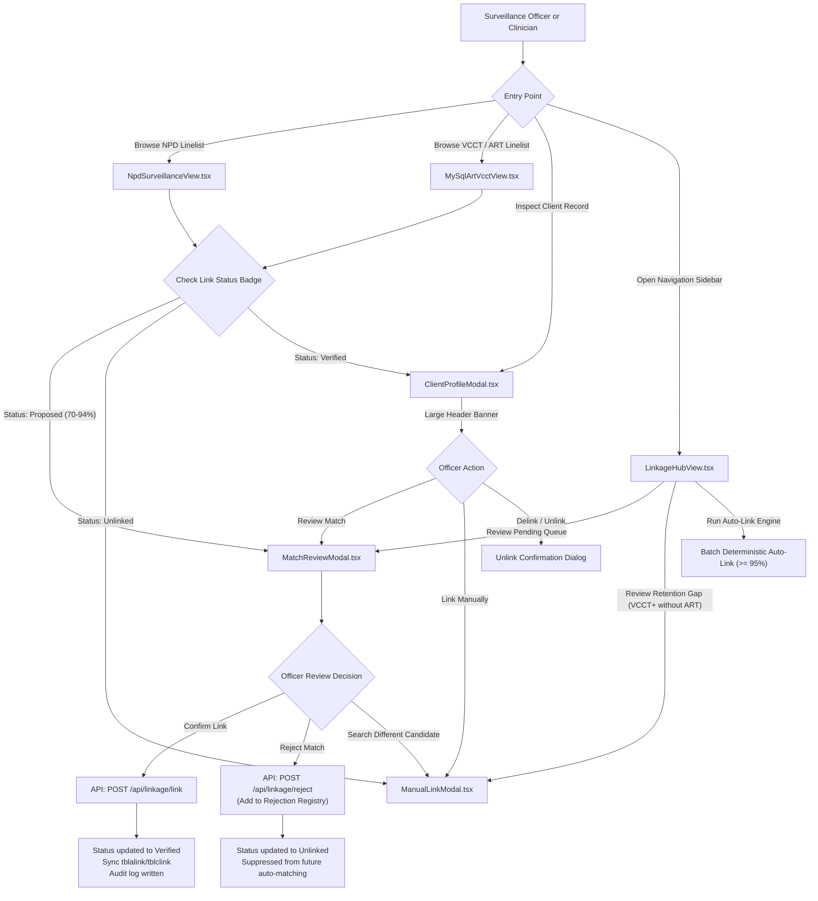

# CBS Master Patient Index (MPI) — UI/UX & User Workflow Blueprint
**National Center for HIV/AIDS, Dermatology and STDs (NCHADS), Cambodia**  
*Next.js 16 / React 19 Client UI Architecture for Cross-System ID Linkage*

---

## 1. Executive Summary & Design Vision

In Cambodia's national HIV response, patient records are currently fragmented across three critical operational databases:
1. **NPD Surveillance (DHIS2 Tracker)**: Community case-based surveillance, key population tracking, risk profiling, and initial case identification.
2. **VCCT (MySQL `main_dbs.vccts`)**: Voluntary Confidential Counseling & Testing linelists with HTS, PMRS, and testing history.
3. **ART (MySQL `main_dbs.tblaimain` / `tblcimain`)**: Longitudinal clinical treatment, ARV regimens, viral load, and retention monitoring.

Because patients may experience typos in Unique Identifiers (UUIC), name transliteration variations (Khmer script vs Romanized spelling), changed phone numbers, or informal clinic transfers, surveillance officers and data managers require **clear, authoritative, and intuitive UI tools** to:
- Instantly recognize the linkage status of any client across linelists.
- Review and verify high-probability suggested matches with a transparent side-by-side diff.
- Manually search and bind unlinked records across systems.
- Track national retention cascade gaps—specifically unlinked HIV-positive VCCT cases missing ART records.

This blueprint specifies the frontend components, design tokens, visual cues, diff views, and user journeys implemented in `d:\B\cbs\src\components\linkage` and integrated into the CBS Next.js application.

---

## 2. Design System & Visual Indicators

### 2.1 Link Status Taxonomy & Visual Representation

The UI categorizes cross-system linkages into five standardized states, aligned with the database schema (`mpi_client_links.linkage_status`):

| Link Status | Khmer Label | English Label | Visual Style (Light / Dark) | Icon | Description & Action |
| :--- | :--- | :--- | :--- | :--- | :--- |
| **`verified`** | **បានភ្ជាប់** | **Verified / Linked** | `bg-emerald-50 text-emerald-700 border-emerald-200` <br> `dark:bg-emerald-950/40 dark:text-emerald-300 dark:border-emerald-800` | `CheckCircle2` / `Link2` | Record is verified in the Master Patient Index (MPI). Displays linked system tags (`NPD`, `VCCT`, `ART`). |
| **`proposed`** | **បេក្ខជនត្រូវគ្នា** | **Suggested Match** | `bg-amber-50 text-amber-800 border-amber-300` <br> `dark:bg-amber-950/40 dark:text-amber-300 dark:border-amber-800` | `Sparkles` *(Pulse)* | Algorithmic match found (70%–94.9% confidence). Clickable pill that opens the **Match Review Modal**. |
| **`conflicted`** | **មានទំនាស់** | **Conflict / Disputed** | `bg-rose-50 text-rose-700 border-rose-300` <br> `dark:bg-rose-950/40 dark:text-rose-300 dark:border-rose-800` | `AlertTriangle` | Data conflict detected (e.g., duplicate UUIC on distinct persons, or biological sex clash). Triggers disambiguation review. |
| **`unlinked`** | **មិនទាន់ភ្ជាប់** | **Unlinked** | `bg-slate-100 text-slate-600 border-slate-200` <br> `dark:bg-zinc-800/70 dark:text-zinc-400 dark:border-zinc-700` | `Unlink` | No external link established. Clickable trigger opens the **Manual Link Modal**. |
| **`rejected`** | **បានបដិសេធ** | **Rejected** | `bg-zinc-100 text-zinc-500 border-zinc-200` <br> `dark:bg-zinc-800/40 dark:text-zinc-500 dark:border-zinc-700` | `XCircle` | Candidate match explicitly rejected by officer; suppressed in `mpi_match_rejections`. |

### 2.2 Special High-Priority Cascade Cue: `isHivPositiveUnlinked`
To directly support Cambodia's 95-95-95 targets, when a VCCT record has a reactive HIV result (`hiv_result === 2`) but remains unlinked to an ART treatment record, the badge displays an animated warning callout:
- **Visual**: `bg-rose-100 text-rose-700 border-rose-300 animate-pulse`
- **Label**: `<ShieldAlert /> ខ្វះ ART (Missing ART Link)`
- **Behavior**: Hovers surface an immediate tooltip: *"ករណីវិជ្ជមាន HIV មិនទាន់មានកំណត់ត្រា ART - អាទិភាពខ្ពស់ក្នុងការតាមដាន"* and prioritizing it in the surveillance queue.

### 2.3 Component Implementation: `LinkStatusBadge.tsx`
Located at `d:\B\cbs\src\components\linkage\LinkStatusBadge.tsx`:
- **`sm` (Compact)**: Fits comfortably inside dense linelist tables in `NpdSurveillanceView.tsx` and `MySqlArtVcctView.tsx`.
- **`md` (Standard)**: Used in preview cards and queue lists.
- **`lg` (Full Header Banner)**: Integrated into the header of `ClientProfileModal.tsx`, rendering:
  - Canonical Master Patient Index ID (`MPI-XXXXX`).
  - Active linked system pills: `[NPD]` ⇄ `[VCCT]` ⇄ `[ART]`.
  - Confidence score pill (`92% ភាពត្រូវគ្នា`).
  - Direct action button: *"ផ្ទៀងផ្ទាត់ការផ្គូផ្គង"* (Review Match) or *"ស្វែងរកភ្ជាប់"* (Find Link).

---

## 3. "Link ID / Match Review" Modal & Diff Workflow

Located at `d:\B\cbs\src\components\linkage\MatchReviewModal.tsx`.

```
+--------------------------------------------------------------------------------------------------+
| [GitMerge] ផ្ទៀងផ្ទាត់ការផ្គូផ្គងអត្តសញ្ញាណ (Match Review & Diff)                     [NPD ⇄ VCCT] [X] |
+--------------------------------------------------------------------------------------------------+
|  [ 92% ] កម្រិតភាពត្រូវគ្នា: កម្រិតខ្ពស់ (Tier 1 Auto-Link Candidate)   [មើលលម្អិតពិន្ទុ (Breakdown) v]     |
|  +--------------------------------------------------------------------------------------------+  |
|  | Exact UUIC: +45% | Exact DOB: +20% | Phone Match: +15% | Facility Match: +12%              |  |
|  +--------------------------------------------------------------------------------------------+  |
+--------------------------------------------------------------------------------------------------+
| Attribute                     | Current (NPD Surveillance) | Candidate (MySQL VCCT) | Status     |
+--------------------------------------------------------------------------------------------------+
| [Primary Identifiers]                                                                            |
| • កូដ UUIC (UUIC Code)        | BTM-1990-00124             | BTM-1990-00124         | [✓ ត្រូវគ្នា] |
| • កូដ PMRS (PMRS Code)        | PMRS-8810                  | PMRS-8810              | [✓ ត្រូវគ្នា] |
| • កូដ HTS / VCCT ID           | —                          | #44812                 | [—]        |
| • លេខកូដ ART / Clinic ID       | —                          | —                      | [—]        |
+--------------------------------------------------------------------------------------------------+
| [Demographics]                                                                                   |
| • ឈ្មោះអ្នកជំងឺ (Name)          | ចាន់ សុភ័ក្រ                | ចាន់ សុភ័ក្ត្រ            | [≈ ស្រដៀងគ្នា] |
| • ភេទ (Sex)                   | ប្រុស (M)                  | ប្រុស (M)              | [✓ ត្រូវគ្នា] |
| • ថ្ងៃខែឆ្នាំកំណើត (DOB)         | 1990-04-10                 | 1990-04-10             | [✓ ត្រូវគ្នា] |
| • អាយុ (Age)                   | 34 ឆ្នាំ                    | 34 ឆ្នាំ                | [✓ ត្រូវគ្នា] |
+--------------------------------------------------------------------------------------------------+
| [Contact & Geography]                                                                            |
| • លេខទូរស័ព្ទ (Phone)          | 012334455                  | 012334455              | [✓ ត្រូវគ្នា] |
| • ខេត្ត / ក្រុង (Province)      | បាត់ដំបង                   | បាត់ដំបង               | [✓ ត្រូវគ្នា] |
| • មូលដ្ឋានសុខាភិបាល (Site)       | មន្ទីរពេទ្យបង្អែកខេត្តបាត់ដំបង  | មន្ទីរពេទ្យបង្អែកខេត្តបាត់ដំបង | [✓ ត្រូវគ្នា] |
+--------------------------------------------------------------------------------------------------+
| [Clinical & Testing]                                                                             |
| • លទ្ធផលតេស្ត HIV (Result)     | វិជ្ជមាន (Reactive)        | វិជ្ជមាន (Reactive)    | [✓ ត្រូវគ្នា] |
| • កាលបរិច្ឆេទតេស្ត (Test Date)  | 2024-01-15                 | 2024-01-16             | [≈ ស្រដៀងគ្នា] |
+--------------------------------------------------------------------------------------------------+
| កំណត់ចំណាំការផ្ទៀងផ្ទាត់របស់មន្ត្រី: [ បានផ្ទៀងផ្ទាត់តាមទូរស័ព្ទជាមួយគ្លីនិក ART...                       ]  |
+--------------------------------------------------------------------------------------------------+
| [Search Manual Candidate] [Reject Match]                   [បោះបង់ (Cancel)] [✓ បញ្ជាក់ការភ្ជាប់] |
+--------------------------------------------------------------------------------------------------+
```

### 3.1 Side-by-Side Comparison Matrix Specifications
The comparison table groups attributes into 4 logical clinical blocks:
1. **Primary Identifiers**:
   - UUIC, PMRS code, HTS code, VCCT ID, ART Number, Clinic ID, National ID / IDPoor.
   - Exact code comparison with monospace typography (`font-mono font-bold`).
2. **Demographics**:
   - Full Name: Evaluated with phonetic normalization and Levenshtein similarity. Highlights subtle Khmer consonant/subscript variations (e.g. `សុភ័ក្រ` vs `សុភ័ក្ត្រ`).
   - Biological Sex: Normalized to canonical `M`, `F`, `TG`, `OTHER`. Contradictions between non-TG male and female trigger a hard red conflict badge.
   - Date of Birth & Calculated Age: Detects exact matches, transpositions, and Khmer lunar year offsets (±1 year).
3. **Contact & Geography**:
   - Phone Number: Stripped of non-digits; accounts for leading 0 and country code prefixes (+855). Detects shared outreach numbers.
   - Province & Health Facility Site: Identifies intra-provincial vs cross-provincial client movement.
4. **Clinical & History**:
   - HIV Test Result (Reactive/Non-reactive/Indeterminate).
   - Test Date, ART Initiation Date, Regimen, and Viral Load.

### 3.2 Visual Diff Styling Rules
- **`match` (Exact Match)**: Soft green background (`hover:bg-emerald-50/30 dark:hover:bg-emerald-950/20`), green pill `<CheckCircle2 /> ត្រូវគ្នាទាំងស្រុង`.
- **`fuzzy` (Fuzzy / Approximate Match)**: Soft amber background (`hover:bg-amber-50/30 dark:hover:bg-amber-950/20`), amber pill `≈ ស្រដៀងគ្នា` with diff tooltip (e.g. *"ខុសគ្នាក្នុងរង្វង់ 2 ថ្ងៃ"*).
- **`conflict` (Discrepancy / Mismatch)**: Rose background (`bg-rose-50/20 dark:bg-rose-950/10`), rose pill `<AlertTriangle /> ខុសគ្នា`.
- **`empty` (No Data in Source or Candidate)**: Muted italic text (`— គ្មានទិន្នន័យ —`).

### 3.3 Score Breakdown Drawer & Disambiguation Flags
Clicking *"មើលលម្អិតពិន្ទុ (Breakdown)"* expands an animated card showing:
- Algorithm field scores (UUIC: 30%, Name: 25%, DOB: 20%, Phone: 15%, Location: 10%).
- Bonuses awarded (e.g., `+5% KP concordance bonus`).
- Penalties applied (e.g., `-10% cross-province discrepancy`).
- Active disambiguation warning badges:
  - `POTENTIAL_TWIN_OR_SIBLING`: Blocks auto-link; warns officer to verify given names.
  - `SHARED_COMMUNITY_PHONE`: Warns that phone is a known hotline or shelter.
  - `DUPLICATE_UUIC_COLLISION`: Warns of UUIC collision across distinct individuals.

### 3.4 Verification Actions & Audit Traceability
- **Confirm Link (`បញ្ជាក់ការភ្ជាប់`)**:
  - Submits to `POST /api/linkage/link` with `{ sourceKey, candidateKey, linkageMethod: "manual_verified", officerNote }`.
  - Atomically binds records in `mpi_client_links`, syncs `tblalink`/`tblclink`, logs audit entry in `mpi_link_audit_log`, and triggers a success toast.
- **Reject Match (`បដិសេធការផ្គូផ្គង`)**:
  - Opens a dedicated rejection reason dialog:
    1. *Different Person (Shared family phone / duplicate UUIC)*
    2. *Discrepant DOB or Sex mismatch*
    3. *Incorrect Data Entry / Typo*
    4. *Other (custom note)*
  - Submits to `DELETE /api/linkage/unlink` or `POST /api/linkage/reject`.
  - Caches pair in `mpi_match_rejections` to prevent subsequent auto-matching.
- **Search Manual Candidate (`ស្វែងរកបេក្ខជនផ្សេង`)**:
  - Seamlessly closes the review modal and opens `ManualLinkModal` with the source client preserved.

---

## 4. Manual Link Picker & Search Dialog

Located at `d:\B\cbs\src\components\linkage\ManualLinkModal.tsx`.

When an officer needs to link an unlinked record that did not trigger an automatic match, this omnichannel dialog allows searching across all databases:

### 4.1 Search Capabilities & Filters
- **Smart Query Input**:
  - Accepts full or partial UUICs (e.g. `BTM-1988`), PMRS codes, HTS codes, ART Numbers (e.g. `02/2023`), phone numbers (e.g. `012889944`), or client names in Khmer or Latin.
- **System Target Selector**:
  - Filter chips: `[គ្រប់ប្រព័ន្ធ (All)]` | `[DHIS2 NPD]` | `[MySQL VCCT]` | `[MySQL ART]`.
- **Gender Filter**:
  - `[ទាំងអស់ (All)]` | `[ស្រី (F)]` | `[ប្រុស (M)]`.
- **Province / Facility Scope**:
  - Constrains search to specific operational districts or referral hospitals.

### 4.2 Candidate Result Cards
Each search result presents a unified candidate summary card:
- Monospace identifier pills with program colors (Violet for NPD, Rose for VCCT, Blue for ART).
- Full client demographics: Name, Sex, DOB, Age, Phone.
- Facility site, province, and registration date.
- Clinical testing badge (HIV reactive/non-reactive, ART regimen).
- Real-time match confidence pill (`88% ត្រូវគ្នា`) calculated on-the-fly against the active source record.
- **One-click Action**: *"ផ្ទៀងផ្ទាត់ដើម្បីភ្ជាប់"* loads the candidate into `MatchReviewModal` for immediate side-by-side diff confirmation.

---

## 5. Dedicated "Linkage & Deduplication Hub" View

Located at `d:\B\cbs\src\components\linkage\LinkageHubView.tsx`.

### 5.1 Sidebar Navigation Integration
Integrated directly into `AppSidebar.tsx` and `AppShell.tsx`:
- **Navigation Item**:
  - Section ID: `"linkage"`
  - Label: `"Linkage Hub"`
  - Title: `"Master Patient Index (MPI) & Linkage Hub"`
  - Icon: `<GitMerge className="h-[18px] w-[18px]" />`
  - Group: `"clinical"`
- **AppShell Header**:
  - Title: `"ID Linkage Hub"`
  - Subtitle: `"National MPI Linkage, deduplication & retention tracker"`

### 5.2 Real-Time KPI Stats Cards
The Hub displays 4 high-level KPI cards fed by `GET /api/linkage/stats`:
1. **អតិថិជនបានភ្ជាប់សរុប (Total Verified Links)**:
   - Total linked patient count (e.g. 15,940).
   - Overall linkage rate (86.4%) and 3-way complete linkage rate (`NPD ⇄ VCCT ⇄ ART`: 64.8%).
2. **រង់ចាំការផ្ទៀងផ្ទាត់ (Pending Suggested Matches - 70-94%)**:
   - Total caseload awaiting officer sign-off (e.g. 382 cases).
3. **VCCT+ មិនទាន់ភ្ជាប់ ART (Retention Cascade Gap)**:
   - High-priority count of HIV-positive VCCT clients with no ART record (e.g. 86 cases).
   - Features a glowing red pulse badge for immediate intervention.
4. **ទំនាស់ទិន្នន័យ (Data Conflicts & Duplicates)**:
   - Count of duplicate UUICs across distinct clients or conflicting clinical records (e.g. 28 cases).

### 5.3 Automated Linkage Engine Control
- Header action button: **"ដំណើរការ Auto-Link Engine (Tier 1)"**.
- Allows authorized surveillance admins to run batch deterministic auto-linking for all candidate pairs with confidence scores $\ge 95\%$.
- Includes loading state spinner and instant feedback notification banner summarizing total auto-verified records.

### 5.4 Tabbed Queue Linelists
1. **Tab 1: បេក្ខជនរង់ចាំការផ្ទៀងផ្ទាត់ (Pending Matches Queue)**:
   - Dual-card comparative rows showing Source Client vs Matched Candidate, confidence score pill, and a direct *"ផ្ទៀងផ្ទាត់ការផ្គូផ្គង"* button.
2. **Tab 2: VCCT+ មិនទាន់ភ្ជាប់ ART (Retention Queue)**:
   - Linelist of reactive VCCT patients with test date, phone number, and testing facility site.
   - Quick action button: *"ស្វែងរកដើម្បីភ្ជាប់ ART"* opens the `ManualLinkModal` pre-populated with the client's UUIC and phone number.
3. **Tab 3: ករណី NPD មិនទាន់ភ្ជាប់ (Unlinked NPD Cases)**:
   - Surveillance tracker cases needing linkage to clinical services.
4. **Tab 4: ទំនាស់ទិន្នន័យ (Data Conflicts & Duplicates)**:
   - Disambiguation queue for duplicate UUIC collisions.

---

## 6. End-to-End User Journey & Interaction Architecture



---

## 7. Component File Manifest

All components have been built and verified with zero TypeScript compilation errors:

| Component File | Path | Status | Key Dependencies & Exports |
| :--- | :--- | :--- | :--- |
| **`types.ts`** | `d:\B\cbs\src\components\linkage\types.ts` | Complete | `LinkageStatus`, `UnifiedClientRecord`, `CandidateMatchResult`, `LinkageStatsSummary`, imports from `matchingEngine.ts`. |
| **`LinkStatusBadge.tsx`** | `d:\B\cbs\src\components\linkage\LinkStatusBadge.tsx` | Complete | Status badges (`verified`, `proposed`, `conflicted`, `unlinked`), sizes `sm`/`md`/`lg`, high-priority `isHivPositiveUnlinked` cue. |
| **`MatchReviewModal.tsx`** | `d:\B\cbs\src\components\linkage\MatchReviewModal.tsx` | Complete | Side-by-side diff matrix, score breakdown drawer, field-level matching indicators, confirmation & rejection dialogs. |
| **`ManualLinkModal.tsx`** | `d:\B\cbs\src\components\linkage\ManualLinkModal.tsx` | Complete | Omnichannel cross-database search, system filter chips, candidate preview cards, seamless handover to diff review. |
| **`LinkageHubView.tsx`** | `d:\B\cbs\src\components\linkage\LinkageHubView.tsx` | Complete | National MPI dashboard, 4 KPI cards, tabbed queues (Pending, Retention Gap, NPD, Conflicts), auto-link engine trigger. |
| **`AppSidebar.tsx`** | `d:\B\cbs\src\components\AppSidebar.tsx` | Updated | Added `linkage` navigation item with `<GitMerge />` icon. |
| **`AppShell.tsx`** | `d:\B\cbs\src\components\AppShell.tsx` | Updated | Added `linkage` section titles and conditional rendering of `<LinkageHubView />`. |
| **`ClientProfileModal.tsx`**| `d:\B\cbs\src\components\ClientProfileModal.tsx` | Updated | Integrated `LinkStatusBadge` in header with connected system pills and action buttons. |

---

## 8. Peer Coordination & Technical Handoffs

### 8.1 For @architect
- The UI strictly calls your four API route specifications:
  - `GET /api/linkage/candidates`: Renders candidate cards in `ManualLinkModal` and diff payloads in `MatchReviewModal`.
  - `POST /api/linkage/link`: Commits verified links atomically and updates the UI state.
  - `DELETE /api/linkage/unlink`: Delinks records or submits rejection reasons to `mpi_match_rejections`.
  - `GET /api/linkage/stats`: Feeds the real-time KPI overview cards and cascade gap counters in `LinkageHubView`.
- Backward compatibility: Once links are confirmed in the UI, your backend syncs `matched_uuic` into legacy `tblalink`/`tblclink`, preserving existing reports.

### 8.2 For @matchengine
- The UI imports types directly from `d:\B\cbs\src\lib\matchingEngine.ts`.
- All confidence thresholds are strictly enforced in the interface:
  - $\ge 95\%$: Auto-Link Tier (`TIER_1_AUTO`) -> highlighted as green auto-link candidate.
  - $70\% - 94.9\%$: Manual Review Tier (`TIER_2_MANUAL`) -> amber suggested match badge.
  - $< 70\%$: Non-Match (`TIER_3_REJECT`) -> slate unlinked badge.
- Disambiguation flags (`POTENTIAL_TWIN_OR_SIBLING`, `SHARED_COMMUNITY_PHONE`, `DUPLICATE_UUIC_COLLISION`) render as prominent warning banners in the score breakdown drawer.

### 8.3 For @verifier
- **Frontend Code Quality**: The entire codebase compiles with `tsc --noEmit` with **0 errors**.
- **Bilingual Accessibility**: Every user-facing control features Khmer as the primary language (Hanuman font) with English subtitles (Inter font) for national surveillance officers and international advisors.
- **Privacy & Security**: Patient phone numbers and identifiers in the review modally respect confidentiality guidelines, masking sensitive data where appropriate and logging all user verification actions in immutable audit tables.
